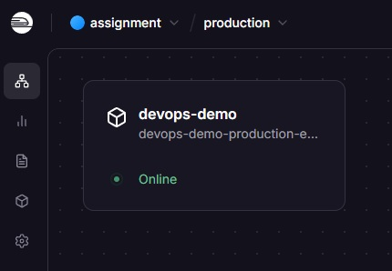
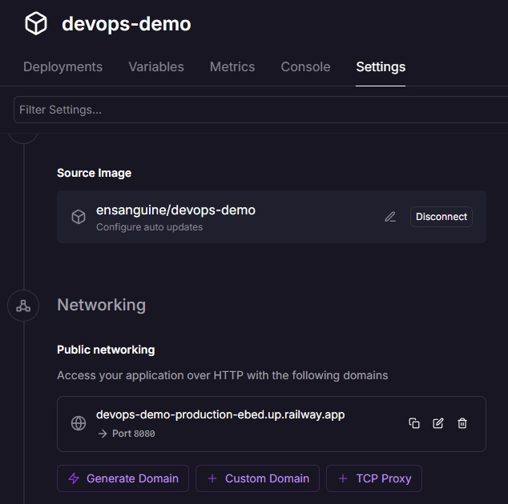
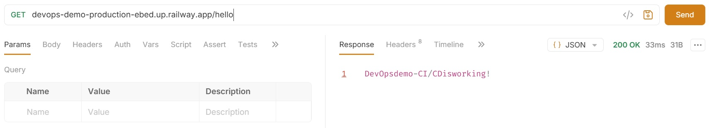
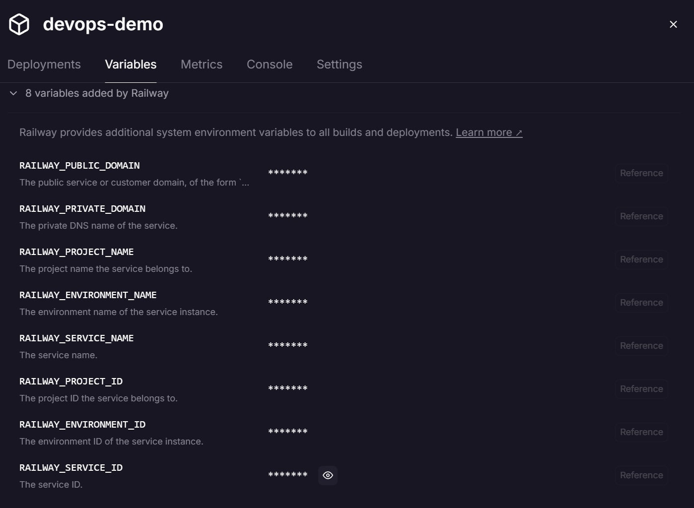
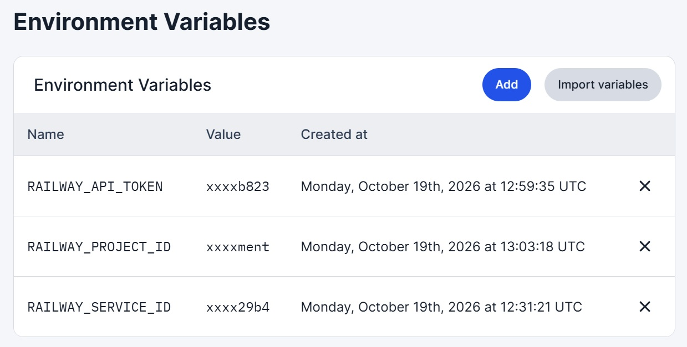
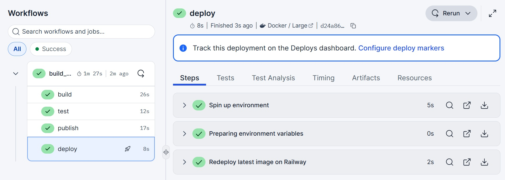
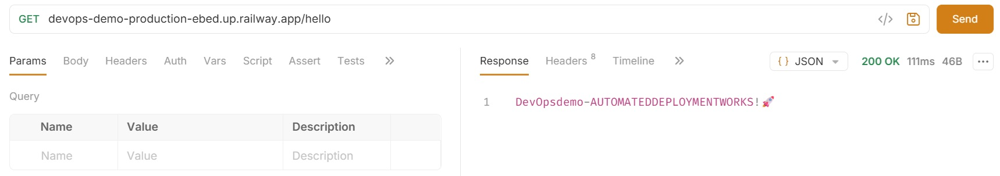

Completed devops-demo for [Lesson 4.12: Continuous Deployment - Automated Deployment to Railway](https://github.com/su-ntu-sctp/ai-4.12-continuous-deployment/blob/main/lesson.md)

## Part 2 Step 3 - Create a Service from Your Docker Image

## Part 2 Step 4 - Generate Public Domain

## Part 2 Step 5: Verify Deployment

## Part 3 Step 3: Add Railway Credentials to CircleCI

## Part 3 Step 6: Verify Deployment

## Part 4 - Testing the Full Pipeline

